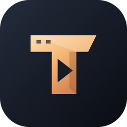

<h1 align="center">Teleflix</h1>

Your Telegram video library, made for your phone. <strong>Developed by xen</strong>

Teleflix is an independent Android client for watching videos from Telegram channels and groups you already have access to. This is the official public repository for APK downloads, documentation and bug reports. The source repository is private.

## Download safely

**Download only from [official Teleflix releases](https://github.com/ankush29922/Teleflix-app/releases).** Do not install repackaged APKs from unknown websites, forwarded files or unofficial mirrors. Every release includes a SHA-256 checksum; compare it with your download. Keep using the same official source for updates.

**0.3.0 scan result:** Microsoft Defender reported no threats in the release APK on 2026-09-30; its signature and SHA-256 were verified. See [SECURITY.md](SECURITY.md) for scope and limitations.

The current release is a **development preview** for Android 8.0 and newer. It is not a Play Store release. It uses a development signing certificate; a future production signing transition will be documented before release.

Teleflix is built as a clean client without advertising SDKs, analytics SDKs, hidden installers or bundled third-party apps. It does not include movies or scrape streaming websites. A source/manifest review and functional tests are not a guarantee that any software is virus-free. See [security and build verification](SECURITY.md) for the checks performed and their limits.

## What it does

- Dark charcoal/copper interface designed for phones.
- Telegram folders and personal channel stacks, pinned channels, and frequently used channel shortcuts.
- One-, two- or three-column video cards with resolution, duration, name and file size.
- Media3 player with double-tap ±10-second seeking, brightness/volume sliders and vertical swipe gestures, playback speed, and available audio/subtitle tracks.
- Watch Later: hold a video to save it; sort by date added, file size or video date.
- Up to three connected Telegram accounts, with separate libraries and cache allowances.
- Storage controls in Settings: 5 GB default per account, 2/5/10 GB presets, custom GB amounts and a clear/increase prompt when full.
- Selective video, image and temporary-file cleanup for one account or all connected accounts.
- Videos up to 4 GB, using bounded ranged reads rather than requiring a full download before playback.

## Permissions and privacy

Each Android permission, its purpose and the data handling are documented in [PERMISSIONS.md](PERMISSIONS.md) and [PRIVACY.md](PRIVACY.md).

Teleflix does **not** request contacts, camera, microphone, location or broad shared-storage access. Brightness changes apply only to the player window; Teleflix does not ask for permission to change global system settings.

## Getting started

1. Download the APK from this repository's Releases page and check the checksum.
2. Install it on your Android phone. Android may ask you to allow installations from the browser or file manager you used; Teleflix itself does not request permission to install other apps.
3. Connect Telegram. This preview requires your own Telegram application API ID/hash from [my.telegram.org/apps](https://my.telegram.org/apps). Enter credentials only in the app, followed by your phone number and Telegram login checks. The country code defaults to +91.
4. Browse Channels, choose a folder/stack, and open a channel to discover its videos. Settings contains storage management and Add account.

## Report bugs

**Found a problem? [Report a bug on GitHub](https://github.com/ankush29922/Teleflix-app/issues/new?template=bug_report.yml).** Include the app version, phone model, Android version, what you did and what you expected. Screenshots are useful after you remove private information.

Never post login codes, passwords, API hashes, phone numbers or private channel content. The app also opens this form from **Accounts & settings → Report a bug**.

## Preview limitations

Basic Telegram playback and phone UI checks have passed. Full 4 GB network stress tests, slow-network seek stress, live switching between multiple real accounts, 16 KB-page-device playback and release-build frame-performance validation are still pending. Available codecs depend on the phone and media. An intermittent closure reported in an earlier preview has not been reproduced or established as fixed.

Teleflix is not affiliated with Telegram or Netflix. It respects Telegram channel access and does not supply or authorize access to copyrighted media. Third-party library notices are in [THIRD-PARTY-NOTICES.md](THIRD-PARTY-NOTICES.md).
